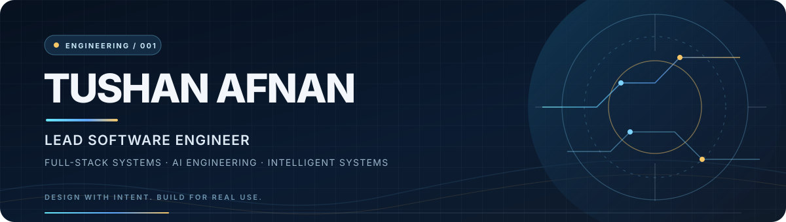

  

  

  
  
  
  
  

  
  
  

  

  

I'm Md. Sultanul Arefin Afnan (Tushan) — a software engineer and MSc Software Engineering student at Dalian University of Technology. I build full-stack applications, backend systems, and APIs, with experience spanning product delivery, platform architecture, team coordination, and production troubleshooting.

My current direction is AI engineering, with interests in agentic AI, machine learning, and intelligent systems. I like working across the full path: understanding the problem, shaping the architecture, implementing the product, and improving it after real use.
<table>
  <tr>
    <td width="33%" valign="top">
      
      <h3>Lead Software Engineer</h3>
      Dalian Penghui Intr Trading Co., Ltd.
       Platform architecture · Team delivery · Technical planning
    </td>
    <td width="33%" valign="top">
      
      <h3>MSc Software Engineering</h3>
      Dalian University of Technology
       Dalian, China · 2025–present
    </td>
    <td width="33%" valign="top">
      
      <h3>Software with purpose</h3>
      Product-focused engineering across frontend, backend, APIs, and applied AI.
       Maintainability · Reliability · User value
    </td>
  </tr>
</table>

  

<table>
  <tr>
    <td width="50%" valign="top">
      

      <h3><a href="https://github.com/tushanafnan/GlucoBuddy">GlucoBuddy ↗</a></h3>
      A machine-learning-based diabetes-risk prediction platform designed to turn user health data into quick risk insights.
        
      <code>Machine Learning</code> <code>Health Data</code> <code>Web App</code>
        
      
      
    </td>
    <td width="50%" valign="top">
      

      <h3><a href="https://github.com/tushanafnan/Zentro">Zentro ↗</a></h3>
      A cloud-kitchen management system organized around food-ordering workflows and a practical, accessible user experience.
        
      <code>JavaScript</code> <code>HTML</code> <code>Bootstrap</code>
        
      
    </td>
  </tr>
  <tr>
    <td width="50%" valign="top">
      

      <h3>Linguasphere</h3>
      A language-learning platform connecting students with verified teachers for one-to-one and small-group sessions. Includes real-time classes, enrollment workflows, and WeChat payments.
        
      <code>React</code> <code>Node.js</code> <code>Express</code> <code>MongoDB</code>
    </td>
    <td width="50%" valign="top">
      

      <h3>Genetically</h3>
      An ancestry and DNA exploration application built with a component-based interface and Firebase-backed services.
        
      <code>React</code> <code>Material UI</code> <code>Firebase</code>
    </td>
  </tr>
</table>

Project descriptions reflect my résumé. Public source links are included where available.

  

<table>
  <tr>
    <td width="25%" valign="top"></td>
    <td valign="top">
      <strong>Lead Software Engineer</strong> 
      Dalian Penghui Intr Trading Co., Ltd. · Dalian, China 
      Lead a small development team, help define platform architecture and delivery workflows, translate business needs into implementation plans, and guide technical decisions.
    </td>
  </tr>
  <tr>
    <td valign="top"></td>
    <td valign="top">
      <strong>Independent Software Engineer</strong> 
      Self-employed 
      Build and maintain full-stack products, working across backend architecture, product usability, feature delivery, troubleshooting, and ongoing performance improvements.
    </td>
  </tr>
  <tr>
    <td valign="top"></td>
    <td valign="top">
      <strong>Software Engineer Intern</strong> 
      <a href="https://gaotek.com">GAOTek Inc.</a> · Remote, United States 
      Built two MERN-stack projects and contributed to frontend features, backend services, issue resolution, and performance improvements.
    </td>
  </tr>
  <tr>
    <td valign="top"></td>
    <td valign="top">
      <strong>Web Programmer</strong> 
      <a href="https://cloudcoin.com">CloudCoin Consortium</a> · Remote, United States 
      Fixed bugs and maintained JavaScript/jQuery functionality, improved interface details, and supported the stability of web-based systems.
    </td>
  </tr>
</table>

  

  

<table>
  <tr>
    <td width="50%" valign="top">
      <h3>🌐 Application engineering</h3>
      
      
      
      
      
      
      
    </td>
    <td width="50%" valign="top">
      <h3>🧠 AI & data</h3>
      
      
      
      
      
    </td>
  </tr>
  <tr>
    <td valign="top">
      <h3>🗄️ Data & delivery</h3>
      
      
      
      
      
      
    </td>
    <td valign="top">
      <h3>🔭 Technical interests</h3>
      
      
      
      
      
      
    </td>
  </tr>
</table>

  

My current technical direction is AI engineering, especially agentic AI and intelligent systems, supported by an application-development background. I am interested in how intelligent capabilities can be integrated into software that is testable, maintainable, and useful in real settings.

My broader technical interests include machine learning, blockchain, cryptography, autonomous systems, and scientific research. I aim to connect theoretical understanding with working implementations and careful evaluation.

  

<table>
  <tr>
    <td width="18%" valign="top"></td>
    <td valign="top"><strong>MSc in Software Engineering</strong> Dalian University of Technology · Dalian, China</td>
  </tr>
  <tr>
    <td valign="top"></td>
    <td valign="top"><strong>B.Eng. in Computer Science and Technology</strong> Dalian Polytechnic University · Dalian, China</td>
  </tr>
</table>

  

  
  

  

  

Stats and contribution visualizations are provided by third-party services and may occasionally be unavailable or delayed.

  

  
  
  
  
  

  
    
  <strong>Build with intent. Engineer for the real world.</strong> 
  Software engineering · Product delivery · Applied AI

