  

  <strong>Software Engineer · AI / ML · Blockchain</strong> 
  Dalian, China · Dalian University of Technology

  <a href="https://tushanafnan.com">Portfolio</a> ·
  <a href="https://www.linkedin.com/in/tushanafnan">LinkedIn</a> ·
  <a href="https://orcid.org/0009-0008-6311-0377">ORCID</a> ·
  <a href="https://www.hackerrank.com/profile/tush_pay">HackerRank</a> ·
  <a href="mailto:tush.pay@gmail.com">Email</a>

---

## About me

I'm **Md. Sultanul Arefin Afnan**, also known as **Tushan**. I build and maintain web applications, backend services, and the systems behind them. My work includes translating business requirements into technical plans, designing APIs, troubleshooting production issues, and coordinating delivery with other developers.

I currently work as a **Lead Software Engineer at Dalian Penghui International Trading** and am pursuing an **MSc in Software Engineering at Dalian University of Technology**. Alongside application engineering, I research machine learning and blockchain and am developing a deeper focus on AI engineering and intelligent systems.

**What I focus on:** Full-stack engineering · Backend architecture · Product delivery · Applied machine learning

## Selected projects

<table>
  <tr>
    <td width="50%" valign="top">
      <h3><a href="https://github.com/tushanafnan/GlucoBuddy">GlucoBuddy</a></h3>
      
A machine-learning-based diabetes-risk prediction application focused on turning health inputs into interpretable risk insights.

      
<code>Machine Learning</code> <code>Health Data</code> <code>Web App</code>

      
<a href="https://gluco-buddy.vercel.app">Live demo</a> · <a href="https://github.com/tushanafnan/GlucoBuddy">Source code</a>

    </td>
    <td width="50%" valign="top">
      <h3><a href="https://github.com/tushanafnan/Zentro">Zentro</a></h3>
      
A cloud-kitchen management project built around food ordering, kitchen operations, and straightforward user workflows.

      
<code>JavaScript</code> <code>HTML</code> <code>Bootstrap</code>

      
<a href="https://github.com/tushanafnan/Zentro">Source code</a>

    </td>
  </tr>
  <tr>
    <td valign="top">
      <h3>Linguasphere</h3>
      
A language-learning platform connecting students and teachers for individual and small-group classes, with enrollment, live sessions, and WeChat payments.

      
<code>React</code> <code>Node.js</code> <code>Express</code> <code>MongoDB</code>

    </td>
    <td valign="top">
      <h3>Genetically</h3>
      
An ancestry and DNA exploration application using a component-based interface and Firebase-backed services.

      
<code>React</code> <code>Material UI</code> <code>Firebase</code>

    </td>
  </tr>
</table>

Public repositories are linked where available; the other projects are included as experience examples.

## Technical toolkit

| Area | Technologies and practices |
| --- | --- |
| **Languages** | JavaScript, Python, Java, C, HTML, CSS |
| **Application development** | React, Next.js, Node.js, Express, FastAPI, Bootstrap |
| **Data and storage** | MongoDB, Firebase, SQL, NoSQL |
| **Machine learning** | scikit-learn, PyTorch, TensorFlow, NumPy, Pandas |
| **Engineering tools** | Git, GitHub, Docker, Linux, REST APIs |
| **Current interests** | Agentic AI, distributed systems, blockchain, cryptography |

## Experience

**Lead Software Engineer** — Dalian Penghui International Trading, China  
*May 2026 – Present*  
Lead technical planning and implementation for web-platform work, coordinate a small development team, and connect business requirements with engineering delivery.

**Independent Software Engineer** — Self-employed  
*June 2019 – Present*  
Build and maintain web products, covering application features, backend services, debugging, and performance improvements.

**Software Engineer Intern** — [GAOTek Inc.](https://gaotek.com)  
*December 2021 – March 2022*  
Worked on MERN-stack projects and contributed to frontend, backend, and issue resolution.

**Web Programmer** — [CloudCoin Consortium](https://cloudcoin.com)  
*February 2020 – May 2021*  
Maintained JavaScript and jQuery functionality, fixed bugs, and improved web interfaces.

## Research and education

My research interests include **machine learning, blockchain-based systems, and reliable intelligent software**. I am especially interested in how these fields can be applied to real engineering problems.

- **MSc, Software Engineering** — Dalian University of Technology (2025 – Present)
- **BEng, Computer Science and Technology** — Dalian Polytechnic University (2021 – 2025)

**Research manuscript:** *Machine Learning Meets Blockchain: A Domain-Oriented Review of Integration Mechanisms, Applications, and Open Challenges* — accepted for publication in *Blockchains* (2026). Publication link will be added when available.

## GitHub activity

These cards are generated using GitHub Actions and saved in this repository. They update on a daily schedule, instead of depending on a public statistics server when the page loads.

  <picture>
    <source media="(prefers-color-scheme: dark)" srcset="./profile/overview.dark.svg" />
    
  </picture>

  <picture>
    <source media="(prefers-color-scheme: dark)" srcset="./profile/contributions.dark.svg" />
    
  </picture>

  <picture>
    <source media="(prefers-color-scheme: dark)" srcset="./profile/languages.dark.svg" />
    
  </picture>

<a href="https://github.com/tushanafnan?tab=overview">View contributions directly on GitHub</a>

---

  <strong>Build with intent. Engineer for the real world.</strong> 
  <a href="https://tushanafnan.com">Website</a> · <a href="https://www.linkedin.com/in/tushanafnan">LinkedIn</a> · <a href="mailto:tush.pay@gmail.com">Get in touch</a>

